# 🎙️ DubStage: On-Device Video Dubbing & Demucs v4 Neural Stem Separation DAW

[](https://github.com/edwinjosephshiju/DubStage-androidStudio/actions/workflows/release.yml)
[-3DDC84?logo=android&logoColor=white)](https://developer.android.com)
[](https://developer.android.com)
[](#system-requirements)
[-FF6F00?logo=onnx&logoColor=white)](https://huggingface.co/StemSplitio/htdemucs-ft-vocals-onnx)
[](#hardware-acceleration-backends)
[](LICENSE)

---

## 🌟 Overview

**DubStage** is a unified on-device **Video Dubbing and Neural Stem Separation Digital Audio Workstation (DAW)** engineered specifically for modern Android devices. It combines Meta's state-of-the-art **Demucs v4 (Hybrid Transformer Demucs)** deep neural separation model running entirely locally via ONNX Runtime with a line-by-line voice dubbing booth, real-time waveform synchronizer, and high-performance MP4 export muxer.

Unlike cloud-dependent dubbing workflows, DubStage processes full audio extraction, neural vocal isolation, voice activity detection (VAD), multi-take voiceover recording, and audio-video remuxing **100% on-device** with zero latency, zero telemetry, and zero privacy compromise.

---

<!-- SCREENSHOT PLACEHOLDER: HERO BANNER -->
```
+---------------------------------------------------------------------------------------------------+
|                                                                                                   |
|                                    [ SCREENSHOT PLACEHOLDER ]                                     |
|                                                                                                   |
|                                DubStage Dark DAW Studio Main Interface                            |
|                            (docs/screenshots/dubstage_hero_banner.png)                            |
|                                                                                                   |
+---------------------------------------------------------------------------------------------------+
```
> *Placeholder: Add `docs/screenshots/dubstage_hero_banner.png` showing the dual-tab DAW interface running on Android in landscape/portrait mode.*

---

## 🧭 Studio Workspaces

DubStage is architected into two integrated workspaces:

```mermaid
graph LR
    subgraph DUBFORGE ["1. DUBFORGE WORKSPACE"]
        A[MP4 Video Source] --> B[Audio Extraction Engine]
        B --> C[Demucs v4 ONNX Neural Engine]
        C --> D1[Vocal Stem WAV]
        C --> D2[Residual Backing Stem WAV]
        D1 --> E[Acoustic VAD & Turn Segmentation]
        E --> F[Script & Cue Editor]
    end

    subgraph DUBSTAGE ["2. DUBSTAGE WORKSPACE"]
        F --> G[Dialogue Cue Selection]
        D2 --> H[Live Backing Monitor]
        G --> I[3s Pre-Roll Countdown]
        I --> J[Hardware AudioRecord 44.1kHz Stereo]
        J --> K[Actor Take Recording]
        K --> L[Dual-Waveform Sync View]
        L --> M[Multi-Take Selection & Audition Deck]
        M --> N[Frame-Accurate MP4 Export Muxer]
    end
```



---

### 1. 🛠️ DUBFORGE: Video Ingestion & Stem Separation

The **DubForge** tab is the preparation engine where video files are imported, audio tracks are extracted, and speech dialogue is isolated from background music, foley, and sound effects.

* **ExoPlayer Video Monitor:** Frame-accurate video preview with synchronized playback control and playhead scrub.
* **Demucs v4 ONNX Separation:** Runs local 44.1 kHz stereo separation using `HT-Demucs` in chunked segments (343,980 frames, ~7.8s) with a 25% overlap-add hop window (85,995 frames) for artifact-free crossfades.
* **Phase-Perfect Residual Backing (`Original - Vocals`):** Subtraction-based residual audio ensures pristine backing tracks with zero spectral comb filtering or synthetic drone artifacts.
* **Neural Sum Mode:** Optional 4-stem sum mode (`Drums + Bass + Other`) for full multi-stem stems.
* **Low-Memory Sequential Pipeline:** Custom non-allocating circular buffers prevent Android runtime Out-Of-Memory (OOM) crashes and `BFCArena` bloat.
* **Acoustic Voice Activity Detection (VAD):** Dual-threshold hysteresis, acoustic pitch ($F_0$) autocorrelation, and spectral brightness centroid profiling to slice vocal stems into clean dialogue cues without splitting continuous utterances or merging distinct speakers.
* **Interactive Cue Editor:** Timecode trimming, custom actor/speaker assignment, script text input, and playhead slicing.

<!-- SCREENSHOT PLACEHOLDER: DUBFORGE -->
```
+---------------------------------------------------------------------------------------------------+
|                                                                                                   |
|                                    [ SCREENSHOT PLACEHOLDER ]                                     |
|                                                                                                   |
|                                      DubForge Workspace View                                      |
|                             (docs/screenshots/dubforge_workspace.png)                             |
|                                                                                                   |
+---------------------------------------------------------------------------------------------------+
```
> *Placeholder: Add `docs/screenshots/dubforge_workspace.png` showing video monitor, separation progress bar, and VAD dialogue cue list.*

---

### 2. 🎙️ DUBSTAGE: Voiceover Booth & Waveform Synchronizer

The **DubStage** tab provides an actor-centric dubbing booth designed for recording, timing alignment, take comparison, and master track auditioning.

* **3-Second Pre-Roll Countdown:** 3... 2... 1... visual countdown with synchronized context backing audio playback, allowing actors to match vocal timing naturally.
* **Low-Latency Hardware Capture:** 16-bit 44.1 kHz stereo recording via Android `AudioRecord` with hardware-calibrated buffer sizing.
* **Live VU & Peak Meters:** Real-time RMS decibel meter (-60 dB to 0 dB) and peak sample indicator with clipping alerts.
* **Interactive Dual-Waveform Visualizer:** Displays the reference original vocal stem waveform alongside the actor's recorded take waveform.
  * Time-offset scrubbing for millisecond-accurate sync alignment.
  * Individual track gain sliders with dB calibration.
  * Zoom and pan across dialogue boundaries.
* **Multi-Take Management:** Record unlimited takes per cue, audition takes individually, rate takes with stars (1-5), and designate master takes.
* **6-Mode Audition Deck:**
  1. `FULL_DUB_MIX` &mdash; Backing track + Selected user takes.
  2. `ORIGINAL_WITH_RESIDUAL` &mdash; Original reference vocal + Backing track.
  3. `RECORDED_WITH_RESIDUAL` &mdash; Active recorded take + Backing track.
  4. `SOLO_ORIGINAL` &mdash; Isolated reference dialogue stem.
  5. `SOLO_ACTIVE_TAKE` &mdash; Isolated actor take for flaw inspection.
  6. `BACKING_ONLY` &mdash; Instrumental and foley without dialogue.
* **Frame-Accurate MP4 Export Muxer:** Real-time software PCM mixer downmixes active takes, encodes into 192 kbps AAC via Android `MediaCodec`, and remuxes with the original video stream via `MediaMuxer`.

<!-- SCREENSHOT PLACEHOLDER: DUBSTAGE BOOTH -->
```
+---------------------------------------------------------------------------------------------------+
|                                                                                                   |
|                                    [ SCREENSHOT PLACEHOLDER ]                                     |
|                                                                                                   |
|                                    DubStage Recording Booth                                       |
|                              (docs/screenshots/dubstage_booth.png)                                |
|                                                                                                   |
+---------------------------------------------------------------------------------------------------+
```
> *Placeholder: Add `docs/screenshots/dubstage_booth.png` showing VU meter, pre-roll countdown, and dual-waveform synchronizer.*

---

## ⚡ Hardware Acceleration Backends

DubStage uses `onnxruntime-android-qnn` to execute neural stem separation across heterogeneous hardware:

| Backend | Execution Provider | Target Hardware | Precision | Description |
| :--- | :--- | :--- | :--- | :--- |
| **QNN NPU (HTP)** *(Recommended)* | Qualcomm QNN (`libQnnHtp.so`) | Snapdragon 8 Gen 2 / 8 Gen 3 Hexagon NPU | FP16 | Fastest on-device execution with lowest thermal dissipation. |
| **QNN GPU** | Qualcomm QNN (`libQnnGpu.so`) | Qualcomm Adreno GPU | FP32 / FP16 | High-throughput GPU execution with burst performance mode. |
| **CPU (Low-RAM)** | ONNX Runtime Default CPU | All ARM64-v8a Devices | FP32 | Universal sequential inference with minimal memory footprint. |

> [!NOTE]
> When QNN execution is selected on unsupported chipsets or when the native QNN runtime libraries are not present, DubStage automatically and seamlessly falls back to the low-memory CPU execution provider.

---

## 🧠 Neural Model Specifications

DubStage supports two Demucs v4 models downloadable directly in the app or sideloadable via file picker:

| Model Preset | Size | Source | Optimization | Recommended Use |
| :--- | :--- | :--- | :--- | :--- |
| **HT-Demucs FT Vocals Specialist** *(Default)* | **166 MB** | [Hugging Face (`StemSplitio/htdemucs-ft-vocals-onnx`)](https://huggingface.co/StemSplitio/htdemucs-ft-vocals-onnx) | FP16 Weights | Fine-tuned vocal specialist with phase-perfect residual backing. |
| **HT-Demucs 4-Stem All-Trained** | **166 MB** | [Hugging Face (`StemSplitio/htdemucs-onnx`)](https://huggingface.co/StemSplitio/htdemucs-onnx) | FP16 Weights | 4-stem model (Drums, Bass, Other, Vocals) for neural sum backing. |

### Built-In Model Downloader
* Resumable HTTP downloads with real-time transfer speed and progress calculation.
* Automatic SHA-256 integrity verification upon download completion.
* Model Sideloading support: load any pre-downloaded `.onnx` model file directly from device storage or SD card.

---

## 📐 Project Architecture

```
DubStage-androidStudio/
├── app/
│   ├── src/
│   │   ├── main/
│   │   │   ├── java/com/example/
│   │   │   │   ├── MainActivity.kt                 # Main Activity & Tab Navigation Controller
│   │   │   │   ├── data/
│   │   │   │   │   ├── database/DubStageDatabase.kt# Room DB definition
│   │   │   │   │   ├── dao/DubStageDao.kt          # Database DAOs (Projects, Clips, Takes)
│   │   │   │   │   ├── model/                      # Entity models (ProjectEntity, ClipEntity, TakeEntity)
│   │   │   │   │   └── repository/                 # Repository layer managing audio files & DB
│   │   │   │   ├── engine/
│   │   │   │   │   ├── DemucsOnnxSeparationEngine.kt # Demucs v4 ONNX inference & QNN provider
│   │   │   │   │   ├── DemucsModels.kt             # Model presets, backend enums & progress state
│   │   │   │   │   ├── ModelManager.kt             # HTTP model downloader & SHA-256 verification
│   │   │   │   │   ├── AudioExtractionEngine.kt    # MediaExtractor + MediaCodec MP4 audio decoders
│   │   │   │   │   ├── AudioRecordingEngine.kt     # Hardware AudioRecord 44.1kHz stereo capture
│   │   │   │   │   ├── PcmSoftwareMixerEngine.kt   # Low-latency multi-track AudioTrack software mixer
│   │   │   │   │   ├── VadEngine.kt                # Adaptive VAD, pitch autocorrelation & turn segmentation
│   │   │   │   │   ├── Mp4ExportMuxer.kt           # AAC MediaCodec encoder & MediaMuxer exporter
│   │   │   │   │   └── WavUtils.kt                 # RIFF/WAV header parsers and peak sample extractors
│   │   │   │   └── ui/
│   │   │   │       ├── DubStageViewModel.kt        # Primary Studio StateFlow ViewModel
│   │   │   │       ├── forge/ForgeTabScreen.kt     # DubForge tab (video monitor, separation, VAD)
│   │   │   │       ├── stage/StageTabScreen.kt     # DubStage tab (booth, takes, audition deck)
│   │   │   │       ├── components/                 # DualWaveformSyncView, VuMeter, VideoMonitor, etc.
│   │   │   │       └── theme/                      # Studio dark design system & color tokens
│   │   │   └── res/                                # Layouts, icons, and theme XML resources
│   │   └── test/                                   # Unit & Robolectric test suites
│   └── build.gradle.kts                            # App Gradle configuration & dependencies
├── .github/
│   └── workflows/
│       └── release.yml                             # Automated Production Release CI/CD Workflow
├── gradle/
│   └── libs.versions.toml                          # Centralized Version Catalog
├── build.gradle.kts                                # Root Gradle configuration
└── settings.gradle.kts                             # Project module settings
```

---

## 📱 System Requirements

| Specification | Minimum Requirement | Recommended Specification |
| :--- | :--- | :--- |
| **Operating System** | Android 7.0 (API Level 24) | Android 13.0+ (API Level 33+) |
| **CPU Architecture** | `arm64-v8a` | Snapdragon 8 Gen 2 / 8 Gen 3 |
| **RAM** | 4 GB | 8 GB+ (for fast neural inference) |
| **Internal Storage** | 500 MB free space | 2 GB+ (for video caches & stems) |
| **Microphone** | Standard built-in stereo mic | External USB-C audio interface / lavalier |

---

## 🔨 Building & Running Locally

### Prerequisites
* **Android Studio:** Meerkat / Ladybug or newer.
* **JDK:** Version 17 (Eclipse Temurin recommended).
* **Android SDK:** API Level 36 with Build-Tools installed.

### 1. Clone the Repository
```bash
git clone https://github.com/edwinjosephshiju/DubStage-androidStudio.git
cd DubStage-androidStudio
```

### 2. Generate Gradle Wrapper (if not present)
```bash
gradle wrapper
```

### 3. Build Debug APK
```bash
./gradlew assembleDebug
```
The output APK will be located at:
```
app/build/outputs/apk/debug/app-debug.apk
```

### 4. Build Production Release APK & Bundle
```bash
./gradlew clean lintRelease assembleRelease bundleRelease --stacktrace
```

---

## 🚀 Automated GitHub Actions CI/CD Release

DubStage includes a fully automated production release pipeline in [`.github/workflows/release.yml`](.github/workflows/release.yml).

### Features
1. **Interactive Version Dispatch:** Trigger releases with a custom semantic version tag (e.g., `v1.0.0`) and pre-release toggle directly in the GitHub Actions UI.
2. **Git Tag Triggers:** Automatically builds and publishes releases on tag pushes matching `v*.*.*`.
3. **Module 6 Anti-Mock QA Audit:** Automated verification scan ensuring zero mock classes, zero synthetic sine generators, and zero fake delays in DSP engines.
4. **Dual-Mode Signing:**
   * **Production Mode:** Signs binaries using `SIGNING_KEY_STORE_BASE64` secret.
   * **Fallback Mode:** Automatically generates a secure self-signed keystore if repository secrets are not yet configured.
5. **Artifact Packaging & Cryptographic Checksums:** Builds and publishes both standalone sideloadable APKs and Google Play AAB bundles along with a `SHA256SUMS.txt` manifest.

### Triggering a Release Manually
1. Navigate to **Actions** in your GitHub repository.
2. Select the **Android Production Release** workflow.
3. Click **Run workflow**.
4. Enter your desired **Release version tag** (e.g. `v1.0.0`) and toggle **Mark this release as a Pre-Release** if appropriate.
5. Click **Run workflow** to initiate automated build, verification, and publication.

---

## 🔒 Permissions & Privacy

DubStage requests only essential hardware permissions:
* `android.permission.RECORD_AUDIO`: For real-time hardware voiceover capture in the DubStage booth.
* `android.permission.MODIFY_AUDIO_SETTINGS`: For low-latency hardware audio buffer configuration.
* `android.permission.INTERNET`: For in-app model downloads from Hugging Face (app operates completely offline once weights are saved).
* `android.permission.ACCESS_NETWORK_STATE`: For network health checks during model downloads.

All audio extraction, neural separation, vocal recording, and MP4 rendering occur strictly on-device.

---

## 📄 License

DubStage is distributed under the Apache License 2.0. See [LICENSE](LICENSE) for details.
